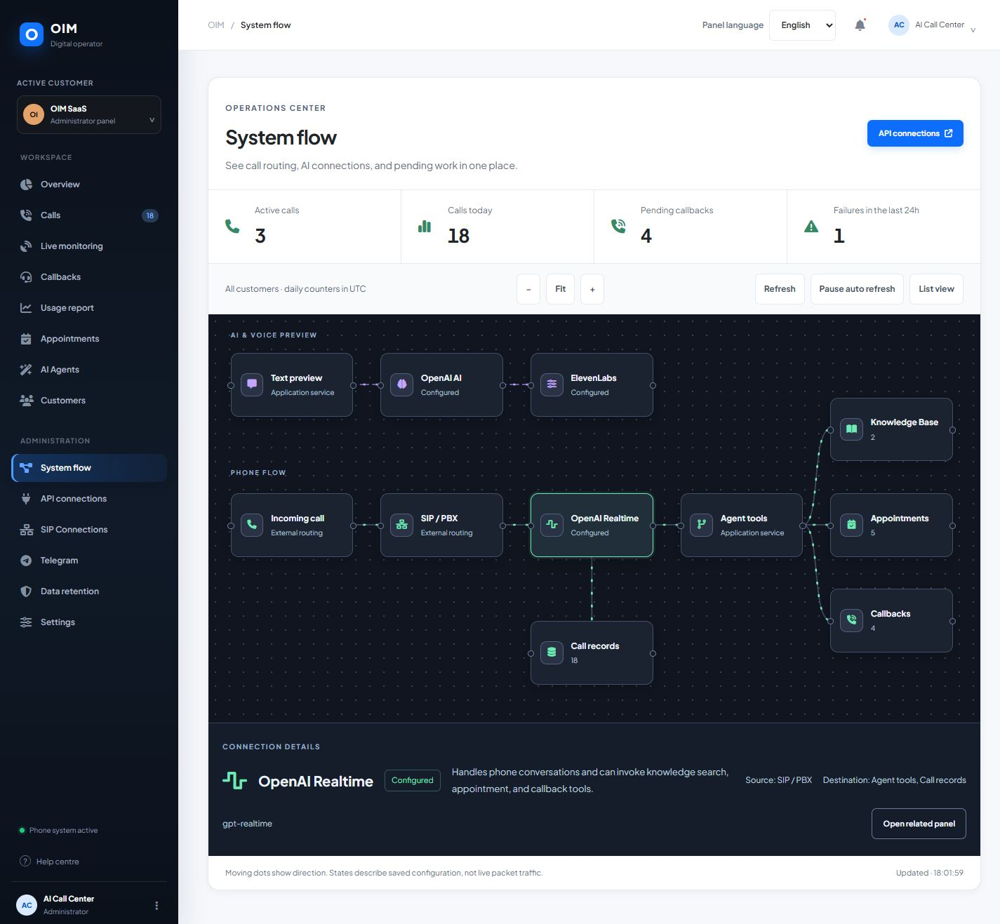
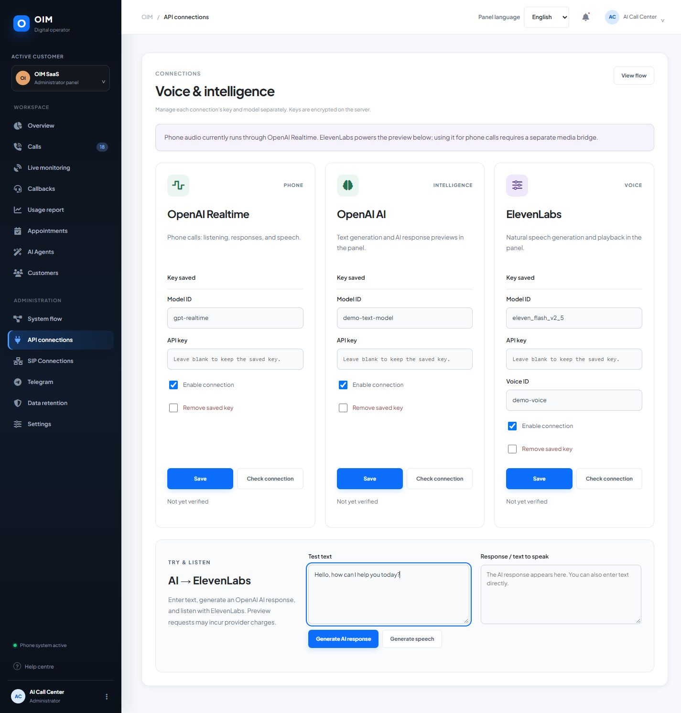
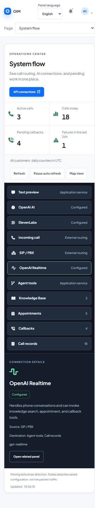
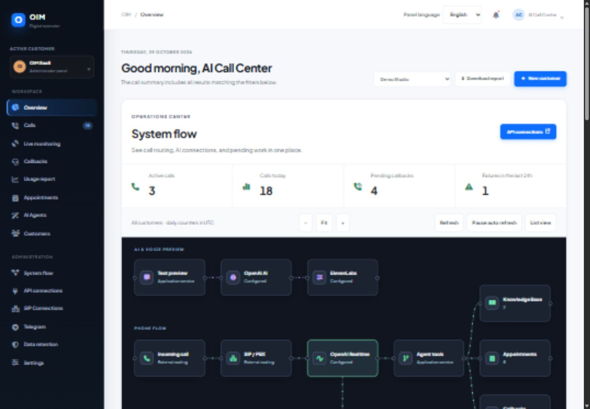
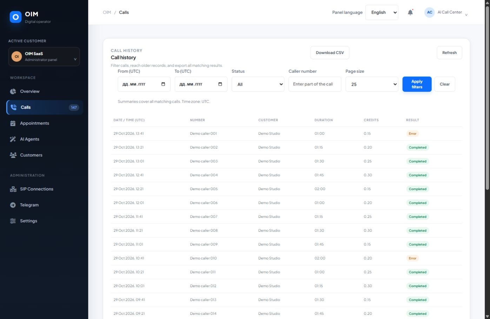
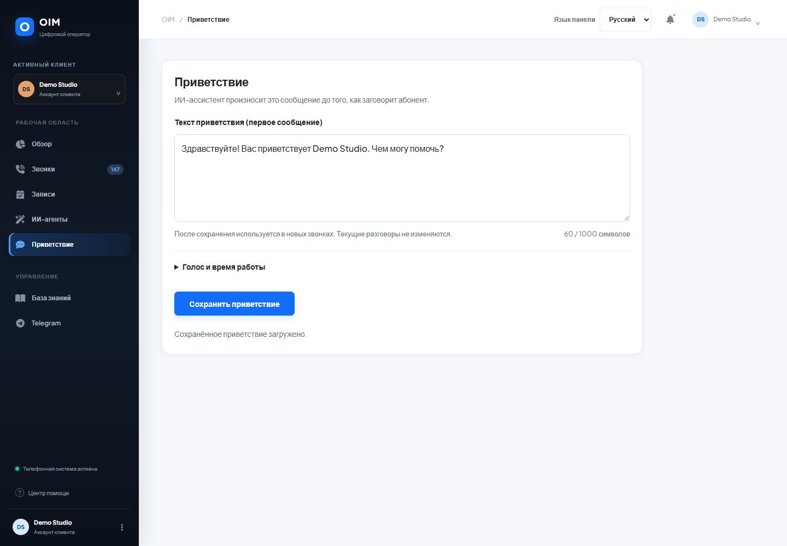
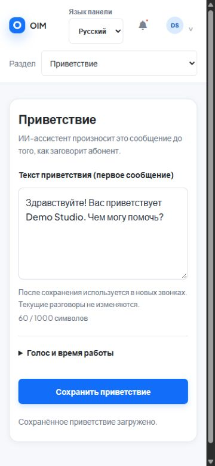

# AI Call Center SaaS

[](https://github.com/isihussain/AI-CallCenter/actions/workflows/tests.yml)

An open-source starting point for a multi-tenant AI telephone assistant. It combines a lightweight Python API, a static customer and administrator dashboard, SQLite storage, OpenAI Realtime voice sessions, optional Google Calendar and Telegram integrations, and an external SIP/PBX connection.

The project is a self-hosted application codebase, not a hosted service. You operate the server, telephone routes, provider accounts, customer data, backups, and legal notices.

## Screenshots

These screenshots use synthetic accounts and calls in a local demo. The dashboard supports Turkish, English, and Russian; the selected language changes interface text without rewriting a customer's greeting or knowledge.















## What it includes

- **Tenant accounts:** administrator and customer roles, password hashing, cookie sessions, per-customer records, and tenant-scoped API routes.
- **Voice agent settings:** editable first greeting, voice selection, and working-hours text. New calls use the saved greeting.
- **Realtime call handling:** OpenAI Realtime API integration, audio-first opening greeting, transcript capture, usage accounting, and call status updates.
- **Business knowledge:** publishable Markdown articles in Turkish, English, and Russian, with retrieval support for the voice agent.
- **Appointments:** voice-agent booking flow, SQLite appointment records, and optional Google Calendar availability checks and event creation.
- **Call history and reports:** server-side UTC date, status, and caller filters; stable pagination; summaries over all matching calls; CSV export across every matching page.
- **Customer operations:** appointment views, CRM contacts, credit ledger, adjustable per-minute billing values, and estimated Realtime usage costs.
- **Optional integrations:** customer-specific Telegram call-recording delivery, Google Calendar OAuth, configurable provider keys, and SMTP settings.
- **Web dashboard:** responsive customer and administrator views, a mobile section selector, and persistent Turkish, English, and Russian interface preferences.
- **Container installation:** a same-origin HTTPS frontend and an unprivileged API, with persistent database and encryption-key storage.
- **Automated checks:** Python API and tenant-isolation tests, dashboard tests, and a disposable HTTPS Compose smoke check in GitHub Actions.

The telephone path depends on your SIP provider and PBX. This repository does not include production SIP credentials, carrier configuration, server logs, customer exports, or a ready-made root-level PBX provisioning program.

## Architecture

```text
Caller → SIP provider / PBX → OpenAI Realtime SIP
                                  ↕
                         Python sideband API
                    ↙ SQLite · Calendar · Telegram
Browser → HTTPS reverse proxy → static dashboard + Python API
```

The browser and API should share one HTTPS origin. The included Nginx example serves `oim-ui/` and proxies `/api/` to the backend. The backend binds to loopback by default.

## Requirements

- Linux server for a production deployment; local development is also possible on macOS or Windows.
- Python 3.11 or newer recommended.
- A web server or reverse proxy that serves the dashboard and forwards `/api/` requests to the Python service.
- An OpenAI API project with access to the Realtime API for voice calls.
- Optional: Asterisk/FreePBX and an inbound SIP trunk, Google OAuth credentials, a Telegram bot, and SMTP credentials.
- Outbound network access from the server to the configured AI and integration providers.

SQLite and the Python standard library provide storage and most HTTP functionality. Python package dependencies are listed in [`requirements.txt`](requirements.txt). `websockets` is pinned to the version used by the original deployment; upgrade it only after checking the Realtime connection code against the newer client API.

## Quick start with Docker

Install Docker with Compose v2 and use its Linux engine. From the repository root:

~~~sh
cp .env.compose.example .env
docker compose up --build -d --wait
~~~

In PowerShell, use `Copy-Item .env.compose.example .env` for the first command. Open `https://localhost:8443`. The local stack generates a self-signed development certificate, which you must trust yourself; use a trusted certificate for a public domain.

On the first start, read the generated administrator credentials privately:

~~~sh
docker compose exec api cat /data/bootstrap-credentials.txt
~~~

Save them in your password manager and remove that file from the data volume. The stack starts without customer accounts or provider credentials. See [container installation](docs/containers.md) for runtime configuration, public TLS, persistent volumes, backups, upgrades, and the separate PBX integration.

## Quick start without Docker

From the repository root:

```bash
python3 -m venv .venv
source .venv/bin/activate
python -m pip install --upgrade pip
python -m pip install -r requirements.txt
cp .env.example .env
```

Edit `.env` for your machine. The application does **not** automatically read this file. In a development shell, export its values before starting the API:

```bash
set -a
. ./.env
set +a
python oim-mvp/backend.py
```

The API listens on the configured `OIM_HOST` and `OIM_PORT` (defaults: `127.0.0.1` and `8787`). The dashboard is static; use the Nginx example below or another same-origin reverse proxy to serve `oim-ui/` and proxy `/api/` to the backend. Opening `index.html` directly or using a basic static file server will not proxy API requests, so sign-in and integrations will not work in that setup.

### First administrator login

On an empty database, the first launch creates one administrator. It generates a unique random password and writes the one-time credentials to `bootstrap-credentials.txt` next to the SQLite database. The file is created with owner-only permissions (`0600`). Keep the database directory outside the web root, read the password through a protected server session, then remove the credentials file after saving it in your password manager.

You may instead set `OIM_BOOTSTRAP_ADMIN_USERNAME` and `OIM_BOOTSTRAP_ADMIN_PASSWORD` through a secret manager **before the first launch**. If a password is supplied that way, no credentials file is written. Remove the bootstrap password from the service environment after the administrator has been created. These bootstrap options do not reset an existing account.

The new database starts with no customer accounts. Sign in as the administrator and create a customer from the dashboard. The customer then configures their greeting, published knowledge, and allowed integrations.

## Linux production deployment

The following is a deployment outline for a new Ubuntu or Debian host. Adjust account names, paths, access groups, domain, firewall, and TLS to match your environment.

1. Install Python, Git, Nginx, and system utilities using your operating system's package manager. Create a dedicated unprivileged service account and directories for the application, database, secret key, and recordings.
2. Clone this repository to `/opt/ai-call-center-saas`. Create a virtual environment there and install `requirements.txt`.
3. Copy `.env.example` to `/etc/ai-call-center.env`. Set `OIM_DB` and `OIM_SECRET` to files in a writable data directory outside the web root. Set `OIM_PUBLIC_URL` to the final HTTPS origin. Restrict the environment file to the service administrator and service account.
4. Copy [`deploy/ai-call-center.service.example`](deploy/ai-call-center.service.example) to `/etc/systemd/system/ai-call-center.service`. Confirm the service user owns the database and secret directories. Grant recording access only if you enable the recording watcher.
5. Copy [`deploy/nginx.conf.example`](deploy/nginx.conf.example) into your Nginx configuration, replace `your-domain.example` and certificate paths, and obtain a valid TLS certificate. The backend session cookie is marked `Secure`, so use HTTPS for browser logins.
6. Create the Google OAuth web client if you enable Calendar. Add `https://YOUR_DOMAIN/api/google/callback` as an authorized redirect URI and set matching `GOOGLE_CLIENT_ID` and `GOOGLE_CLIENT_SECRET` values in the protected environment file.
7. Set `OPENAI_API_KEY` and `OPENAI_WEBHOOK_SECRET` if you use the OpenAI Realtime voice flow. Configure the provider-side webhook to the HTTPS URL `/api/openai/webhook` and use the secret supplied by that provider.
8. Start the service, check its status and health endpoint, then sign in and configure the provider in the administrator panel:

   ```bash
   sudo systemctl daemon-reload
   sudo systemctl enable --now ai-call-center
   curl --fail http://127.0.0.1:8787/api/health
   sudo systemctl status ai-call-center
   ```

The sample systemd unit applies basic service hardening. Review its `ReadWritePaths` if you use different data or recording locations. Do not expose the backend port directly to the internet; serve it behind the TLS reverse proxy.

## Configuration reference

| Variable | Purpose | Example |
| --- | --- | --- |
| `OIM_HOST` | Backend bind address. Keep it on loopback behind a reverse proxy. | `127.0.0.1` |
| `OIM_PORT` | Backend HTTP port. | `8787` |
| `OIM_DB` | SQLite database path. Keep it outside the web root and back it up. | `/var/lib/ai-call-center/oim.db` |
| `OIM_SECRET` | Fernet key file used to encrypt stored provider and integration secrets. Protect it like a password. | `/var/lib/ai-call-center/.secret` |
| `OIM_RECORDINGS` | Directory watched for recordings to deliver through Telegram. | `/var/spool/asterisk/monitor/ai-call-center` |
| `OIM_PUBLIC_URL` | Public HTTPS origin used to construct Google OAuth callback and return URLs. | `https://voice.example.org` |
| `OIM_CREDITS_PER_MINUTE` | Initial default credit rate inserted for a new database. The administrator can change billing values in the dashboard. | `0.1` |
| `OIM_BOOTSTRAP_ADMIN_USERNAME` | Username for the initial administrator, used only when creating an empty database. | `admin` |
| `OIM_BOOTSTRAP_ADMIN_PASSWORD` | Optional first-run password. If blank, the application generates one and writes it to the protected credentials file. | Set through a secret manager |
| `OPENAI_API_KEY` | Optional server-side fallback key for OpenAI Realtime. You can also configure a key in the administrator panel. | Never commit a real key |
| `OPENAI_WEBHOOK_SECRET` | Secret used to verify OpenAI webhook signatures. Webhook requests are rejected if it is missing or invalid. | Set through a secret manager |
| `GOOGLE_CLIENT_ID` | Optional Google OAuth client ID. | Set in your environment |
| `GOOGLE_CLIENT_SECRET` | Optional Google OAuth client secret. | Set through a secret manager |

Other integrations are configured in the dashboard: Telegram bot token and chat, SMTP settings, customer SIP account details, customer AI greeting and voice, and per-tenant knowledge articles. The application stores the Fernet key separately from encrypted values; losing that key makes those values unreadable.

## OpenAI Realtime and PBX setup

1. Configure a provider key in the administrator dashboard or set the server-side `OPENAI_API_KEY` fallback.
2. Create a webhook in your AI provider account that targets `https://YOUR_DOMAIN/api/openai/webhook`. Store its signing secret as `OPENAI_WEBHOOK_SECRET` and keep it private.
3. Configure the provider and PBX to route the inbound SIP call to the Realtime SIP endpoint used by this application. Confirm codecs, network access, RTP media, caller-ID handling, and any carrier allowlists with your SIP provider.
4. In the administrator dashboard, create a customer and enter the correct SIP credentials for that tenant. The voice agent reads its configured greeting immediately when the Realtime sideband connects, even if the caller has not spoken yet.
5. Test with a controlled test trunk and a non-production customer account before routing public calls.

The SIP settings endpoint invokes `/usr/bin/sudo /usr/local/sbin/oim-apply-sip` after saving credentials. That privileged helper is **not included** in this repository because PBX file paths, dial plan, carrier registration, and firewall rules are specific to each operator. Until you install and review your own root-owned helper and narrowly scoped sudoers rule, the SIP settings cannot be applied to Asterisk from the panel. Never permit the web service to run arbitrary commands as root.

## Dashboard languages and call reports

Use the language selector on the login screen or dashboard to choose Turkish, English, or Russian. The preference stays in that browser. Switching language preserves saved business text and current edits to the greeting and knowledge forms. On narrow screens, use the section selector in the header. See [dashboard languages](docs/dashboard-languages.md) for details and translation maintenance.

In **Calls**, select a UTC date range, status, caller substring, and page size, then apply the filters. Previous and next controls reach older records. Summary cards cover every matching call, including rows on other pages. Refresh starts a new snapshot so newly arrived calls can appear.

The CSV report downloads all matching call pages. It stops if any page fails, rather than downloading a partial report. The file also includes the latest 100 appointments for the selected tenant and states that separate coverage. See the [call-history API reference](docs/call-history-api.md) for query parameters, ordering, response fields, and snapshot limits.

## Readiness, monitoring, reviews, and privacy

Administrators also have an interactive **System flow** dashboard with aggregate call counters, selectable nodes, source/destination details, zoom controls, and a mobile list view. **API connections** provides separate encrypted settings for OpenAI Realtime, OpenAI AI, and ElevenLabs, plus explicit text and voice previews. The current phone route uses OpenAI SIP; ElevenLabs phone audio requires a separate media bridge. See [admin connections and system flow](docs/admin-console.md) for setup, limits, and endpoint details.

The dashboard includes a tenant-scoped setup readiness panel, a greeting preview, active and failed call monitoring, a callback queue, editable call reviews, and usage reports. The greeting preview uses the saved text and optional browser speech; it does not place a telephone test call or verify an operator PBX route. Human follow-up is recorded as a callback request, not a live transfer. Quality indicators use a documented deterministic rubric and show which signals were available.

Customers can configure transcript retention from their dashboard. Configure the daily cleanup timer before relying on a retention policy: see [operations and retention setup](docs/operations.md) and the example [systemd service](deploy/ai-call-center-retention.service.example) and [timer](deploy/ai-call-center-retention.timer.example). Cleanup removes expired transcripts and call-review summaries/notes while preserving billing and call metadata. Recordings stored by an external PBX need a separate retention policy.

## Tests

Install the Python dependencies, then run the API and voice-opening regression tests from the repository root:

```bash
python -m unittest discover -s oim-mvp/tests -v
```

These tests use temporary databases and synthetic accounts. They cover authenticated requests, customer isolation, administrator permissions, contact mutations, call filters, pagination, usage aggregation, readiness checks, callback requests, reviews, transcript retention, and the first Realtime greeting. Outbound provider requests are mocked.

Dashboard checks require Node.js 22+ and pnpm 11.25.0:

~~~sh
pnpm install --frozen-lockfile
pnpm test
~~~

They check translations, saved preferences, preservation of form values, pagination, complete report collection, and stale responses after switching tenants. The shipped dashboard remains plain static JavaScript and needs no Node runtime or build step.

With Docker running, check the complete local HTTPS stack:

~~~sh
python scripts/smoke_compose.py
~~~

The smoke check creates its own disposable stack, signs in with synthetic credentials, verifies routing and the API's unprivileged user, then recreates containers to check database and encryption-key persistence. It removes only its own stack and volumes. No test needs provider keys, a PBX, or real calls.

[GitHub Actions](.github/workflows/tests.yml) runs on pull requests and pushes to main. Stable jobs are **Regression (Python 3.11)**, **Regression (Python 3.13)**, and **Compose HTTPS smoke**. Regression jobs also run the dashboard checks on Node.js 22; all jobs run without repository secrets.

## Operations and data protection

- Back up the SQLite database and the `OIM_SECRET` key together using an encrypted, access-controlled backup. Test restoring both as a pair.
- Keep `.env`, service environment files, bootstrap credentials, database files, SIP credentials, customer records, audio, transcripts, and logs out of Git and out of public issue attachments.
- Restrict the data directory and recording access to the service and backup operators. Set a retention period for recordings and transcripts that matches your customer agreements and applicable law.
- Rotate provider credentials through the provider when they may have been disclosed. Deleting a key from the current source tree does not invalidate an already exposed key or remove it from Git history.
- Replace the sample privacy and terms pages with documents reviewed for your service and jurisdiction before onboarding customers.
- Configure TLS, host firewall rules, backups, monitoring, rate limits, log retention, and incident response for your deployment. The sample files are starting points, not a complete production security review.

## Project layout

```text
oim-mvp/backend.py                 Python API, SQLite schema, integrations, Realtime handling
oim-mvp/purge_transcripts.py       Scheduled transcript-retention cleanup entry point
oim-mvp/tests/                     API, tenant-isolation, operations, and voice-opening tests
oim-ui/index.html                  Login and dashboard markup
oim-ui/app.js                      Dashboard behavior and API calls
oim-ui/call-history.js             Filters, pagination, reviews, quality signals, and reports
oim-ui/operations.js               Readiness, monitoring, callbacks, usage, and retention panels
oim-ui/admin-console.js            Admin provider forms, AI/voice previews, and system-flow map
oim-ui/admin-console.css           Responsive admin connection and workflow styling
oim-ui/i18n.js                     Browser language selection and text bindings
oim-ui/locales.js                  Turkish, English, and Russian message catalog
oim-ui/tests/                      Dashboard regression tests
oim-ui/styles.css                  Dashboard styling
oim-ui/login.css                   Login styling
oim-ui/help.html                   Generic deployment help
oim-ui/knowledge-*.md              Knowledge prompt and language templates
deploy/                            Example systemd and Nginx configuration
docs/                              Container, API, operations, language guides, and synthetic screenshots
scripts/                           Development certificate and Compose smoke check
Dockerfile / Dockerfile.web         API and frontend images
compose.yaml                       Persistent same-origin HTTPS stack
.github/workflows/tests.yml         Python, dashboard, and container checks
.env.example                       Safe configuration template with blank secrets
.env.compose.example               Safe container configuration template
requirements.txt                   Python package dependencies
package.json / pnpm-lock.yaml       Locked dashboard test and formatting tools
```

## Contributing

Issues and pull requests are welcome. Before submitting, remove customer information, public IPs taken from logs, access tokens, API keys, database files, recordings, and deployment-specific credentials. For a suspected security issue, use GitHub's private vulnerability reporting if it is enabled for this repository; do not post a working secret or exploit in a public issue.

## License

Released under the MIT License. See [`LICENSE`](LICENSE).


